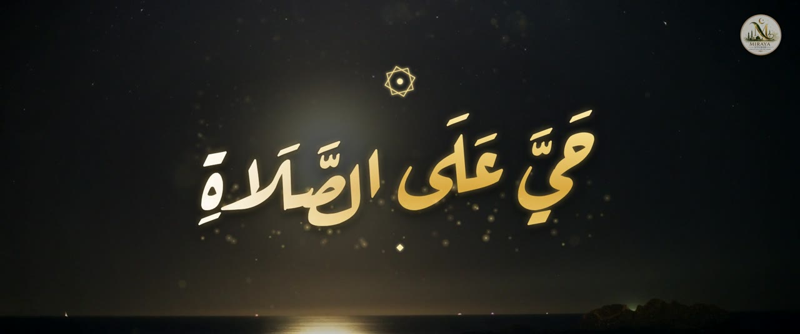
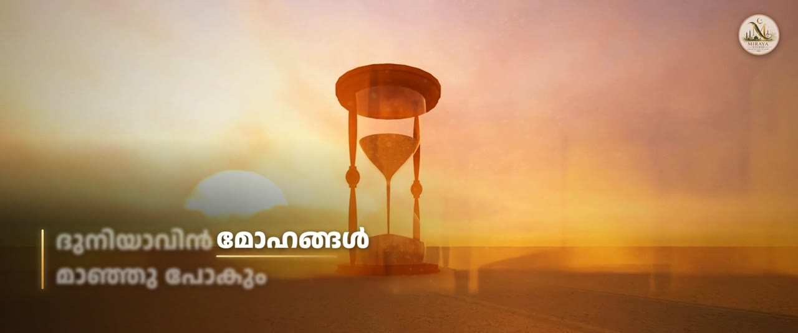

# حَيَّ عَلَى الصَّلَاةِ — Cinematic Malayalam lyric video

Production source for the *Niskaram / നിസ്കാരം* lyric video by **Miraya Studio**.
Everything is script-driven, so the film can be re-rendered after any change (new lyrics, different shots, new credits).

| | |
|---|---|
| Frame | **2.39:1 widescreen, 1920 × 804**, 24 fps, H.264 + AAC 320 k |
| Intro | One adhan call (*Hayya ʿala-ṣ-ṣalāh*, 11.6 s) **tuned +2.1 semitones to the song's key** (see *Adhan decision*), fading into the song's own humming |
| Song | `inputs/song.mp3`, **complete and uncut from 0:00**, placed at 0:09.2 so the humming enters under the adhan's last note |
| Lyrics | Left lower-third, wrapping to 2–3 lines. **Live word highlight**: the word being sung is sharp, bright and underlined, every other word of the line is soft-focus |
| Visuals | One shot per lyric line, chosen for what the line says; the picture changes when the line is first sung |
| Logo | Miraya Studio badge as a quiet corner bug for the whole film, large on the end card |
| Length | 5 min 17 s |





## Timeline

| Time | What |
|---|---|
| 0:00 – 0:11 | Adhan (first call). Opening credits, 2.7 s each, letter-by-letter animation: **Music** – Miraya Studio · **Editor** – Jabir Varikkodan · **Mixing & Visuals** – Miraya Studio · **Lyrics** – Jabir Varikkodan. |
| 0:10 | The song's humming enters under the adhan's last note (film time = song time + 9.2 s). |
| 0:11 – 0:20 | The calligraphic Arabic title **حَيَّ عَلَى الصَّلَاةِ** (the word "Title" is not shown). |
| 0:20 – 0:23 | Humming continues over a sunrise above the clouds. |
| 0:23.6 – 5:10 | 54 lyric lines (first line sung at song time 14.4 s). |
| 4:59 – 5:17 | End credits, then the full logo card ("Thank you for watching"). |

## Loudness

The supplied song is −14.1 LUFS (peak −2.5 dBFS); the first cuts of the film kept that level. The delivered audio is mastered **−9.1 LUFS integrated, −1.3 dBTP after the AAC encode** (about +5 dB louder than the original): `project.json → master` (gentle 2.4:1 compressor, make-up gain found by iteration so the integrated loudness hits `target_lufs`, look-ahead limiter at `ceiling_db`). Loudness range drops from 5.2 to 2.2 LU. Set `master` to `null` to get the unmastered mix back. Re-master an existing video without re-encoding it: `python3 tools/compose.py remux IN.mp4 OUT.mp4`.

## Adhan decision (analysis)

You asked me to analyse whether the adhan belongs in front of the humming. Measured on the supplied files (`tools` + the numbers below, pitch-class histograms of voice and music):

| | key centres found |
|---|---|
| adhan, first call | C♯ (+80 ¢), a quarter-tone E (+360 ¢), D♯, G♯; last held note ≈ A3 (217 Hz) |
| song | F (tonic, +510 ¢), then C, D♯, G♯, A♯, F♯; the humming's long note is C4/B3 |

Correlation of the adhan's pitch distribution with the song: **−0.10 as recorded**; it peaks at **+200…+225 ¢ (≈ +2 semitones): 0.55 (whole song), 0.61 (humming)**; no other shift in ±3 semitones comes close. Shifted by +210 ¢ the adhan's centres land on F, D♯ and A♯, and its last note lands on the humming's B3 plateau (B – D♯ – F♯ is a major triad against the humming's first notes). So the adhan is kept – one call only – and tuned (`project.json → adhan_pitch_cents`, formant-preserving). Set it to `0` to hear the original; a second copy of the film with the original-pitch adhan was rendered too (`..._original_pitch_adhan.mp4`, audio swap only: `ALT_AUDIO=1 ./build.sh audio` builds `work/audio_original_pitch.wav`).

## Picture

* 55 shot clips + 3 texture overlays from Mixkit (see `docs/FOOTAGE_CREDITS.md`). `tools/plan_edl.py` maps each lyric line to a picture (hourglass for *desires fade*, a lone tree for *alone in the grave*, a storm for *the first question*, sujood for *did you pray*, rain for tears, a waterfall and rainbow for paradise, a sunrise for *success in both worlds* …); the four hook lines get a new picture each time they return. Section changes use light-bloom or dip-to-black transitions.
* Colour: custom teal-gold 3D LUT, highlight bloom, gold dust, soft vignette, fine grain (`tools/make_lut.py`, `tools/compose.py`).
* **Halal check:** all clips were reviewed frame-by-frame. There are no women, no exposed awrah, no music/dance/alcohol; the only people are men at prayer or reading the Quran, and hands.

## Lyrics — please proofread

The SRT that reached me contained only **four cues** (0:15–0:36). Those are exact (`inputs/lyrics_user_supplied_partial.srt`). The other **50 lines were reconstructed from the song itself** (two speech-recognition passes over the vocals, cross-checked) and may contain wrong words or spellings. They are in `inputs/lyrics.srt`; `docs/LYRICS_REVIEW.md` lists every line with a confidence note.

### Word timing (the live highlight)

`tools/align_words.py` force-aligns every word to the audio (wav2vec2 / MMS-300m CTC aligner, ONNX int8, text romanised with `uroman`) and writes `inputs/words.json`, which `tools/prep.py` reads. The same hook line comes back at +21.3 s, +53.3 s, +64 s … and the aligner puts each of its words within ~0.08 s of the same place every time, which is the check I used. Result: **the lines are really sung ~0.6 s earlier than the times in the SRT** (first line at 14.4 s, not 15.0 s); the film follows the audio.

To change lyrics: edit `inputs/lyrics.srt`, then
```bash
pip install onnxruntime numpy uroman
# model: https://huggingface.co/Corvo007/mms-300m-1130-forced-aligner-int8  (model.onnx, vocab.json) -> ./aligner/
python3 tools/align_words.py ./aligner && cp work/words.json inputs/words.json
./build.sh overlays final        # (and: shots base final  if the number of lines changed -> tools/plan_edl.py)
```
Without a fresh alignment a changed line falls back to an even split of its SRT window.

## Re-render

```bash
./build.sh all                 # footage → shots → overlays → audio → base → final   (~50 min on 4 cores)
./build.sh overlays final      # new lyrics / credits only (~10 min)
WORK=/scratch ./build.sh shots # keep the ~3 GB of intermediates somewhere else
```

Requirements: ffmpeg ≥ 6 (libx264, libass not needed), Node 18+ with Playwright + Chromium, Python 3 with Pillow.

| File | Purpose |
|---|---|
| `project.json` | sizes, song offset, credit texts and timings, logo bug |
| `edl.json` | the shot list (Mixkit id, in-point, start time on the film, transition, zoom) |
| `overlay/overlay.{html,js}` | all animated graphics, rendered frame-exactly in headless Chromium |
| `tools/*.py` / `tools/render_overlays.mjs` | footage download, shot building, LUT, audio mix, compositing |
| `fonts/` | Anek Malayalam, Noto Naskh Arabic, Aref Ruqaa, Cinzel, Cormorant Garamond (SIL OFL) |

## Swapping footage

Each shot in `edl.json` is `{id, in, t, tr, trd, z0, z1, cy, ...}`. To use your own clip put it at `$WORK/src/<id>.mp4` (any resolution/fps; it is cropped to 2.39:1 automatically) and give the shot that `id`. `in` is the in-point in seconds, `cy` shifts the 2.39:1 crop vertically (0 = top … 1 = bottom), `z0 → z1` is the slow push/pull. Then `./build.sh shots base final`.

## Notes

* Title spelling: the brief wrote `حي عل الصلاة`; the title uses the standard `حَيَّ عَلَى الصَّلَاةِ`.
* **Footage licence – please read before uploading.** All footage is from Mixkit. **23 of the 58 clips** (stars, moon and dusk time-lapses, the desert and several mosque exteriors, the texture overlays) are under the *Mixkit Stock Video Free License* (free for commercial use). The other **35 – including the drone mosque shots, the Quran, the prayer footage and the rain/storm shots – are under the *Mixkit Restricted License*: the clip page offers them "for personal use only"**. If the channel is monetised you need either the Envato licence for those clips or replacement footage. Per-clip status and links: [`docs/FOOTAGE_CREDITS.md`](docs/FOOTAGE_CREDITS.md). Swapping is a one-line change per shot (below).

## Swapping footage

Each shot in `edl.json` is `{id, in, t, tr, trd, z0, z1, cy, ...}`. To use your own clip put it at `$WORK/src/<id>.mp4` (any resolution/fps; it is cropped to 2.39:1 automatically) and give the shot that `id`. `in` is the in-point in seconds, `cy` shifts the 2.39:1 crop vertically (0 = top … 1 = bottom), `z0 → z1` is the slow push/pull. Then `./build.sh shots base final`.

## Notes

* Title spelling: the brief wrote `حي عل الصلاة`; the title uses the standard `حَيَّ عَلَى الصَّلَاةِ`.
* **Footage licence – please read before uploading.** All footage is from Mixkit. Only **11 of the 52 clips** (the stars/moon/dusk time-lapses, three mosque exteriors and the texture overlays) are under the *Mixkit Stock Video Free License* (free for commercial use). The other **41 clips – including the drone mosque shots, the Quran and the prayer footage – are under the *Mixkit Restricted License*: the clip page offers them "for personal use only"**. If the channel is monetised you need either the Envato licence for those clips or replacement footage. Per-clip status and links: [`docs/FOOTAGE_CREDITS.md`](docs/FOOTAGE_CREDITS.md). Swapping is a one-line change per shot (below).
* The song audio is untouched except for gain-neutral summing with the adhan and a −0.3 dB safety limiter; programme loudness is about −13.8 LUFS.
